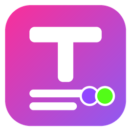

# XDK Titre

Change le **titre et le jeu du live sur Twitch et Kick en même temps**, pour les lives de la TEAM XDK.

- Un titre, un jeu (recherche sur les deux plateformes à la fois), un clic : Twitch et Kick sont à jour.
- Modèles de titres à recharger en un clic.
- Mises à jour automatiques et signées.

**Réservé à l'équipe XDK** : il faut une clé pour ce PC, donnée par le bot du Discord XDK TEAM DEV.
Windows 10 / 11, avec le .NET 8 Desktop Runtime (x64) et Microsoft Edge WebView2 (déjà dans Windows).

Téléchargement : [dernière version](https://github.com/XDTEAMDev/XDK-Titre-releases/releases/latest), ou dans **XDK Hub** → Logiciels PC.
